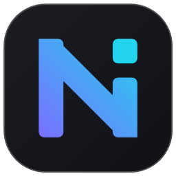
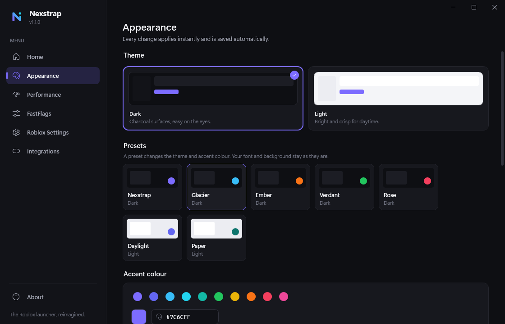
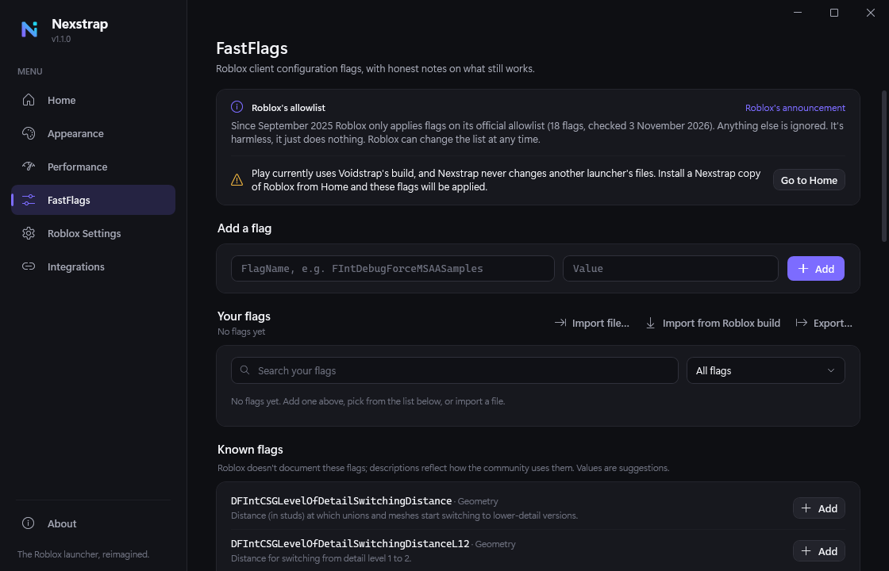
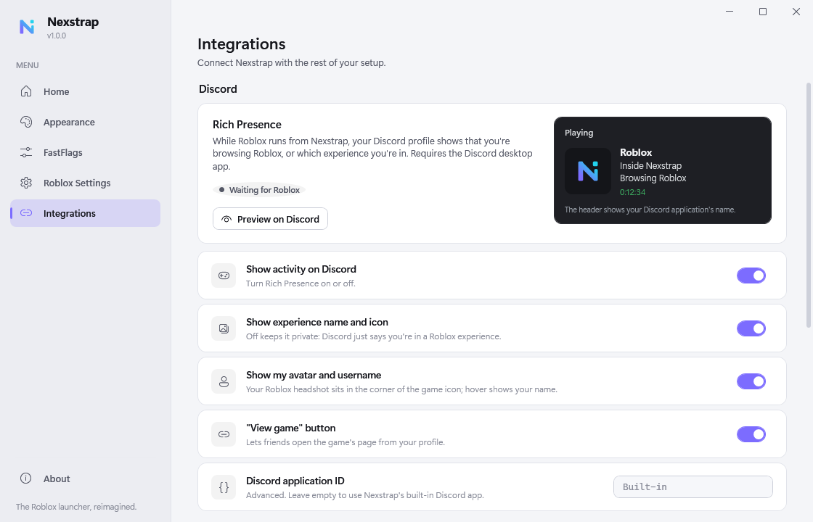

<p align="center">
  
</p>

<h1 align="center">Nexstrap</h1>
<p align="center"><b>The Roblox launcher, reimagined.</b><br/>
A modern Windows launcher for the official Roblox client, with themes, honest FastFlags, Discord Rich Presence and a verified self-updater.</p>

<p align="center">
  <a href="https://github.com/brandtmajxi-wq/nexstrap/releases/latest"><b>Download the latest release</b></a>
</p>

---



## What it does

- **Play and join**: start Roblox, or join any experience by place ID or roblox.com link (with name, creator and player count shown first).
- **Games**: favorites and recently played with thumbnails, quick Play and desktop shortcuts.
- **Servers**: browse an experience's public servers, filter by free slots and ping, and join a specific one.
- **Loading screen**: your own text, colours, background and animation while Roblox starts.
- **Installs Roblox for you**: downloads the official, unmodified Roblox Player from Roblox's own servers, checks every file against Roblox's checksums, and keeps it up to date.
- **Setup**: installs for your Windows account without admin rights, with shortcuts and a clean uninstall from Windows Settings. It can also run without installing.
- **Six languages**: the whole app in English, Deutsch, Español, Français, Português (Brasil) or Русский.
- **Appearance**: dark and light themes, any accent colour, any installed font, background images, presets, and themes you can save, share and import. Changes apply instantly. An opt-in Roblox font setting can also change the font in Nexstrap-installed Roblox builds.
- **FastFlags, honestly**: add, edit, toggle, import and export flags with type checking and automatic backups. Every flag is marked **Applied** or **Ignored**, based on Roblox's published allowlist (since September 2025 Roblox ignores everything else).
- **Performance**: see how your frame-rate cap compares with your display, apply presets, and choose the graphics API, anti-aliasing and texture quality. It changes limits and quality; it can't make your PC faster.
- **Roblox Settings**: frame-rate cap, graphics quality, fullscreen, volume and camera options, the same settings as Roblox's own menu, with backups.
- **Discord Rich Presence**: "Inside Nexstrap · Browsing Roblox" in the menu (with your own text if you like); the game's name, icon, your avatar and a *View game* button in game.
- **Integrations**: start programs alongside Roblox (and close them after), and move your whole setup to another PC with one file.
- **Notifications**: Nexstrap and Roblox updates and setup warnings in one inbox, with preferences for each.
- **Self-updating**: checks this repository's releases on every launch and installs updates only after verifying them.

More detail: [docs/FEATURES.md](docs/FEATURES.md).

| FastFlags | Integrations (light theme) |
|---|---|
|  |  |

## Install

Nexstrap is one file that installs itself. No admin rights are needed.

1. Download **`Nexstrap.exe`** from the [latest release](https://github.com/brandtmajxi-wq/nexstrap/releases/latest).
2. Double-click it.
   - Windows SmartScreen may say *"Windows protected your PC"*, because the program isn't code-signed yet.
     Click **More info → Run anyway**.
3. In setup, choose your language, install location and shortcuts, or pick **Run without installing**.
4. On **Home**:
   - If you already have Roblox (from roblox.com, Bloxstrap, Voidstrap or Fishstrap) Nexstrap finds it automatically. Press **Play Roblox**.
   - Otherwise press **Install Roblox** (about 225 MB, downloaded from Roblox).

**Optional**
- To make the **Play** buttons on roblox.com open through Nexstrap, turn on *Roblox Settings → Open website Play buttons with Nexstrap*. Turning it off gives them back to whatever handled them before.
- For FastFlags to take effect, Play has to use a Roblox build Nexstrap installed: *Home → Installations → Install a Nexstrap copy*. Nexstrap never changes files that belong to other launchers.

**Requirements:** Windows 10 or 11 (64-bit). Nothing else: the .NET runtime is included in the exe.

## Updating

Nexstrap checks for a new version each time it opens (you can turn this off on Home). When one is available a banner appears; open **Home → Nexstrap updates → Download & install**.
An update is installed only if it comes from this repository's releases **and** its size, SHA-256 checksum, product name and version all match. Otherwise it's deleted and nothing changes.

## Uninstall

Open **Installed apps** in Windows Settings and uninstall Nexstrap. It gives Roblox links back to your previous launcher and asks whether to keep or delete your data.

If you ran it without installing:
1. If you turned on *Open website Play buttons with Nexstrap*, turn it off first (this restores your previous launcher).
2. Delete `Nexstrap.exe`.
3. Delete `%LocalAppData%\Nexstrap` (settings, logs, themes, backups and any Roblox builds Nexstrap installed).

## Privacy

Nexstrap has no accounts, ads or telemetry. It only talks to:
- **github.com**, to check for and download Nexstrap updates;
- **Roblox's public servers**, to download the Roblox client and look up public game and avatar info;
- **the Discord app on your PC**, for Rich Presence (if enabled).

Roblox sign-in links from the website are passed straight to Roblox and never written to Nexstrap's logs.

## Troubleshooting

- **About → Copy diagnostics** copies your version and system details; **About → Logs** opens the log folder.
- Roblox's own settings can only be changed while Roblox is closed (it saves its own copy on exit).
- If Rich Presence doesn't appear, make sure the Discord **desktop** app is running and *Integrations → Show activity on Discord* is on.

## Building from source

Requires the [.NET 10 SDK](https://dotnet.microsoft.com/download) on Windows.

```powershell
dotnet build Nexstrap.slnx
dotnet test Nexstrap.slnx
powershell -File tools/package-release.ps1     # → artifacts/release-v<version>/
```

See [docs/RELEASING.md](docs/RELEASING.md) for publishing a release.

## License

Nexstrap is released under the [MIT License](LICENSE). It uses .NET/WPF, CommunityToolkit.Mvvm and Microsoft.Extensions (all MIT).

## Disclaimer

Nexstrap is an independent project and is not affiliated with, endorsed by or sponsored by Roblox Corporation or Discord Inc. Roblox is a trademark of Roblox Corporation. Nexstrap starts the official Roblox client and does not modify it or bypass any of its security or anti-cheat systems.
